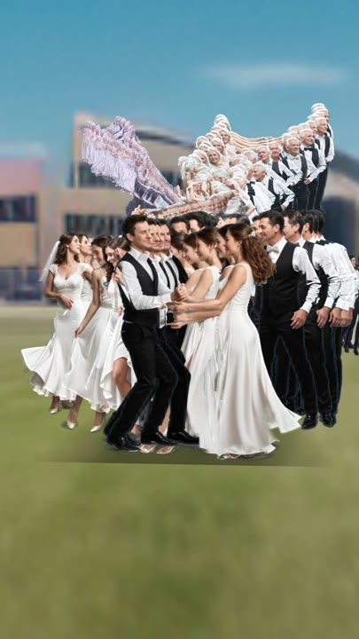

# Time Strata

### Turn motion into a sculpture of time.

**Time Strata** is a video art extension for Stable Diffusion WebUI Forge. It extracts a moving subject from a video or image sequence, arranges its frames as layers in a 3D scene, and lets you animate a camera through the result.

A dance becomes a winding ribbon of movement. A gesture becomes a tunnel. With the optional Deforum workflow, one performance can evolve through different ages, characters or visual styles along the same path.

<p align="center">
  <a href="https://github.com/Shai7net/sd-forge-time-strata/blob/main/docs/media/one-dance-sixty-years-en.mp4">
    
  </a>
  <br>
  <strong>One Dance, Sixty Years</strong><br>
  <a href="https://github.com/Shai7net/sd-forge-time-strata/raw/refs/heads/main/docs/media/one-dance-sixty-years-en.mp4">Watch or download the example · 16 seconds · 1080 × 1920 · 30 fps</a>
</p>

## Features

- **Video and image sequences.** Import a video, a ZIP of frames, or multiple images, including transparent PNGs.
- **Clean subject extraction.** Use existing transparency, colour keying, BiRefNet, rembg models or optional Robust Video Matting. Alpha cleanup, edge decontamination and body alignment help keep stacked frames clear.
- **Sculpt motion in space.** Arrange layers along a line, arc, S-curve, rising path or spiral, or **steer the trail by hand**: while the shot plays (or while Deforum draws), the arrows, W A S D, an on-screen joystick or DeforumationQT turn it left and right and make it climb. Adjust spacing, orientation and twist. Reuse a chain's frames in another arrangement.
- **Animate time.** Display all layers at once, consume the chain as the present advances, or grow a trail behind the present.
- **Direct the camera.** A **follow camera** keeps the figure where you want it — from which side, how high, how large in the picture, where it looks — and swings smoothly with the trail's turns; its proportions come from the lens and the figure's height. Or use keys along the chain, presets, and turn a freely chosen view into a keyframe.
- **Slice through the scene.** Animate a cutting plane to reveal a cross-section through the layers.
- **Build a setting.** Choose sky and ground colours or upload a 360° panorama. Optional Simulation 360 integration can copy an existing panorama into your project.
- **Transform the performer.** Optional Deforum generation draws a new figure over a motion chain — or straight from a video you give it — with **scenes** along the time (each with its own prompt, blended into the next), an optional **texture fill** of the figure (water, fire, stone…), and **ControlNet units** for pose, depth, edges, silhouette (QR Monster) and the look of a picture (IP-Adapter). **Keep the look steady** draws one frame of each scene first and holds every frame of the scene to it, so faces and costumes do not change from frame to frame. Each frame appears in the 3D view as soon as it is drawn.
- **Sharper frames.** Deforum's own Real-ESRGAN upscaler (realesr-animevideov3, realesrgan-x4plus, realesrgan-x4plus-anime) can enlarge small footage before the cut, Deforum's drawn frames before theirs, or any chain afterwards (**Make them sharper**), for sharp close-ups.
- **Export with music.** Record H.264 MP4, optional NVIDIA NVENC MP4 or VP9 WebM, with portrait, landscape and square sizes and optional supersampling.
- **Work locally.** Projects and exports stay on your machine. The scene runs in your browser with WebGL2; Python handles frame preparation and video encoding.

The visual technique is inspired by video strata and David Daniels' Strata-Cut. The scene uses layered image planes: camera movement, spacing and transparency create its sculptural appearance.

## Forge compatibility

Time Strata targets the Forge family through shared extension callbacks, a small Gradio HTML host and a browser-rendered editor. Its memory adapter supports both Forge backend layouts.

| Host | Integration | Verification status |
| --- | --- | --- |
| Legacy Forge | `ldm_patched.modules.model_management` | Adapter and image-processing tests pass locally; example supplied from the author's installation |
| [Forge / Forge 2 (V2)](https://github.com/lllyasviel/stable-diffusion-webui-forge) | `backend.memory_management` | Upstream API checked; adapter tested; full host render still needs validation |
| [Forge Neo](https://github.com/Haoming02/sd-webui-forge-classic/tree/neo) | `backend.memory_management` and shared callbacks | Upstream API checked; adapter tested; full host render still needs validation |

**Compatibility is feature-dependent.** Importing footage, arranging layers and recording do not require a diffusion checkpoint or Deforum. AI generation additionally requires a working combination of Deforum, ControlNet, checkpoint, pose model and sampler in your Forge installation. A model supported by Forge itself does not automatically have Deforum support.

The installer adds missing essentials and keeps existing packages. Torch, CUDA, Gradio and ONNX Runtime are managed by your Forge installation. Automated tests exercise the standalone core and integration adapters; they do not launch each Forge variant. See [compatibility notes](docs/COMPATIBILITY.md) for verification scope and a host test checklist.

## Installation

### Through Forge

1. Open **Extensions → Install from URL**.
2. Paste `https://github.com/Shai7net/sd-forge-time-strata` and install.
3. **Completely stop and restart Forge** so its extension installer runs.
4. Open the **Time Strata** tab. Refresh the browser if its assets are stale.

### With Git

Run this from the folder containing Forge's `webui.py`:

```bash
git clone https://github.com/Shai7net/sd-forge-time-strata.git extensions/sd-forge-time-strata
```

Restart Forge. A portable installation may call this folder `webui`; use that folder rather than the outer launcher directory.

### Requirements

- A working Forge-family installation and its own Python environment.
- A modern browser with **WebGL2** and hardware acceleration enabled.
- NumPy, Pillow, OpenCV and `imageio-ffmpeg`, installed automatically only when their imports are missing. FastAPI and Gradio come from Forge.
- Internet access for initial packages and requested model downloads. Video decoding and encoding use the FFmpeg executable provided by `imageio-ffmpeg`.

Start with transparent images or a video on a plain backdrop: these workflows need no AI matting packages. General-background removal requires additional packages; see [optional model setup](docs/COMPATIBILITY.md#optional-background-removal).

## Your first scene

1. **Create a project.** Choose **New project** and enter a name.
2. **Add footage.** In **Chains**, add a video or image sequence. A clear subject, complete body and steady camera make a useful starting point.
3. **Choose the cut.** Use the source's alpha channel, colour keying for a plain backdrop, or a matting model. Limit the source interval and frame count for the first attempt.
4. **Build the chain.** Wait for extraction and alignment. Inspect the preview and any suspect frames before increasing the sequence length.
5. **Shape the path.** Adjust the spine, spacing and orientation. Choose how the present moves through the chain.
6. **Set the camera.** Try a preset, then adjust the keys. Drag to orbit, scroll to change distance, and right-drag or Shift-drag to pan. Double-click returns to the keyed view.
7. **Choose the world and shot.** Set the background, duration and output dimensions. Use the planner to balance frame count, spacing and camera speed.
8. **Record.** Open **Record**, choose a format and optional music, then click **Record**. Keep the page open until recording finishes.

Projects save automatically. Default locations, relative to Forge's data directory:

```text
time-strata/<project>/          Project document, uploads and prepared chains
models/time-strata/             Downloaded matting models
output/time-strata/             Exported videos
```

Change project and export locations under **Settings → Time Strata**. Back up the entire project folder, including uploads and chains; the JSON document alone does not contain the media.

## Steering the trail and the follow camera

1. In **Camera**, choose **Follow the figure** and a ready-made move (**In front**, **From the side**, **Close up**, **Reveal the trail**…). Drag on the picture to turn around the figure, use the wheel for its size in the picture, and click **A key here** to keep it at that moment; the sliders set the same values precisely.
2. Press **🎮 Steer** under the picture. The shot plays, and **← →** (or **A D**) turn the trail, **↑ ↓** (or **W S**) make it climb; the joystick on the picture does the same. Left and right are the screen's, so the figure goes where you push from any camera angle. The camera follows with a calm swing.
3. A take ends where the shot ends; **Chains › Steering** shows the trail from above, the steering strength and smoothing, **Undo the last steering** and **Straighten the trail**.
4. **DeforumationQT:** tick **Steer from DeforumationQT** in the same section. Its pan left/right and up/down steer the trail, its rotation turns the follow camera around the figure and its zoom brings it closer. Time Strata only reads DeforumationQT's mediator; nothing there is changed.

## Generating with Deforum, ControlNet and scenes

1. In **Generate**, choose a motion chain — or give a video of a moving figure, which is cut into a motion chain first.
2. Write **Who is drawn**, or add **Scenes along the time** (Infinite-Zoom style: each scene starts at a second of the motion and blends into the next over **Blend**). **Four elements** and **A life** are ready-made sets. A scene may carry its own **Texture** (filling the figure before it is drawn) and **Look** picture (IP-Adapter).
3. Under **ControlNet**, switch on what should hold the drawing to the motion: **Pose** is enough for a person; add **Silhouette** for a figure made of something else (water, fire, smoke), **Depth** or **Edges** for more of the body. Each unit has a weight and the part of the steps it acts in. A unit without a model in this Forge is shown as left out.
4. **Keep the look steady** (under ControlNet) draws one frame of each scene first — from the moment its figure is largest — and gives every frame of the scene that frame's look through IP-Adapter. Prompts that dress the figure ("a water warrior in long robes, surrounded by swirling water") hold better than "a body made of water", which the model tends to draw bare; the anchor's look spreads to the whole scene, so it is worth a short test with **Every** 50 first.
5. Choose the **Checkpoint** (Forge's own is put back afterwards), sampler, steps, how much of the motion frame is kept and, for sharp close-ups, **Sharper drawn frames (Real-ESRGAN)**; then **Generate with Deforum**. The new chain grows in the 3D view frame by frame; press **🎮 Steer** to move it through space while it grows. At the end it is cut cleanly (the backdrop's colour together with BiRefNet-lite, so see-through figures stay whole) and stands where the motion stood.

**Drawing some frames again.** When a few frames come out wrong (a face, a hand, a frame that the cut flags), choose the drawn chain under **Draw into** and use **Draw some frames again**: only those frames are drawn again — with the scenes and settings as they are now, usually with a new seed, and with the anchors of a steady look kept — and the chain is cut again; every other frame stays exactly as it was. **Draw them again** beside a chain's wrongly-cut frames fills them in for you.

## Optional: one dance across a lifetime

The example demonstrates a creative use of Deforum: preserve the movement of a performance while changing its appearance along the timeline.

1. Build a clean motion chain from your source video.
2. Install and enable a Forge-compatible Deforum extension exposing its Python API, plus compatible ControlNet/OpenPose assets.
3. In the generation controls, choose the motion chain and a **new** destination chain.
4. Choose a checkpoint, sampler, seed and settings that work in your Deforum setup. The supplied LCM/SD 1.5 defaults assume matching assets; adjust or remove the LoRA prefix if those assets are absent.
5. Add prompt stages for the progression, then generate and inspect the cutouts.
6. Arrange the generated chain, animate the camera and record the scene.

Time Strata prepares Video Input and pose guidance, uses a flat backdrop, and fixes Deforum's camera. Its direct Python integration does not require `--deforum-api`. A compatible DeforumationQT switch, when present, is disabled in memory during the job and restored afterwards.

## Performance and troubleshooting

| Symptom | What to try |
| --- | --- |
| Tab missing | Enable the extension, fully restart Forge and check its console for import or installation errors. |
| Blank 3D view | Enable browser hardware acceleration and WebGL2. Refresh and inspect the browser console for `[Time Strata]` errors. |
| Haze or walls around the subject | Improve the matte and remove faint background alpha. Residual opacity accumulates across hundreds of layers. |
| Flickering silhouette | Try another matting method, improve the backdrop and review suspect frames. |
| VRAM pressure | Reduce resolution, chain length or supersampling. Prefer a lighter matting model and avoid simultaneous image generation while extracting subjects. |
| Missing ONNX/rembg module | Follow optional model setup using Forge's Python. Alpha and colour-key workflows can be used immediately. |
| NVENC export fails | Select ordinary **MP4**. NVENC requires a supported NVIDIA GPU, driver and FFmpeg encoder. |
| Deforum unavailable | Enable a compatible extension with `scripts/deforum_api.py`; check the checkpoint, pose model and sampler. |
| Folder button on Linux/macOS | Automatic Explorer opening currently applies to Windows. Open the configured path manually. |

Extraction uses ONNX Runtime's CUDA provider when available, with CPU as fallback. Speed and memory use depend on the model, provider, footage and hardware. Full-size BiRefNet models can be substantially heavier than the lite variant. RVM files must be supplied manually.

**Graphics memory and BiRefNet-lite.** Before a cut, Time Strata asks every memory manager the host has loaded to release its models (a Forge with files of two generations can have both). BiRefNet-lite needs about 6 GB in full precision and under 4 GB in half precision, with practically the same cut (99.95% overlap on test footage). A half-precision copy (`birefnet-general-lite.fp16.onnx` beside the original in `models/time-strata`) is used automatically when present; make it once with `tools/make_birefnet_fp16.py` (the script's header shows a one-line `uv` command that keeps Forge's environment untouched). When the card still has too little free memory, the chain is cut again from its first frame with a lighter model (RVM for videos, u2net otherwise) and the chain's panel says so, instead of failing part-way.

**Real-ESRGAN.** The upscaler is `realesrgan-ncnn-vulkan`, the program Deforum ships in `models/Deforum/realesrgan_ncnn` (it runs on the graphics card through Vulkan). Without Deforum it is downloaded once, from the same release and checked against the same checksum, into `models/time-strata/realesrgan_ncnn`. Measured on 1024 × 768 drawn frames with an 8 GB laptop card: realesr-animevideov3 ×2 0.5 s a frame (clean, fast), realesrgan-x4plus ×2 5.3 s (the most real detail), realesrgan-x4plus-anime ×2 1.9 s (painterly). A ×4 model asked for ×2 upscales ×4 and is brought down.

**Steadier cuts.** A frame whose cut jumps from its neighbours keeps only what lies near the figure in the frames around it, and separate pieces that lie mostly above the head or below the feet (stage lights, signs) are removed. For footage whose camera moves up and down, choose **Ground → Feet always on the ground**. Black bars around a video's picture (a wide film inside an upright video) are found and cut away first, and the background is judged on the first two seconds, so a dark fade-in is not taken for a flat backdrop.

## API and development

Routes are available at **`/time-strata`** on Forge's own server. No additional server or `--api` flag is needed for these routes. See the [API guide](docs/API.md) for JavaScript, Python and curl examples.

Run standalone tests from this extension's root:

```bash
node --test tests/core.test.js
python -m unittest discover -s tests -p "test_*.py"
```

Use Forge's Python, or a separate environment with `numpy`, `opencv-python-headless`, `Pillow`, `fastapi`, `httpx` and `imageio-ffmpeg`. Tests use temporary projects and do not download models. CI covers the core on Node.js and Python on Windows and Linux; Forge UI and Deforum validation are separate manual checks.

For bug reports, include the Forge repository/branch/commit, OS, Python version, GPU, matting method, reproduction steps and relevant error. Remove private paths and prompts from shared logs.

## Credits and license

Created by **[Shai7net](https://github.com/Shai7net)** with development assistance from Claude. Publication preparation and Forge compatibility adapters were assisted by Codex.

Thanks to the Forge and Forge Neo maintainers and the creators of Deforum, ControlNet, BiRefNet, rembg, Robust Video Matting, FFmpeg and the other libraries used by the project.

Extension source code is available under the [MIT License](LICENSE). The example video and preview are demonstration media, excluded from the source-code license. Models, checkpoints, footage, music and third-party software retain their respective licenses.
